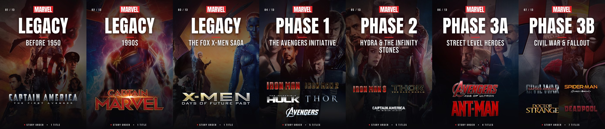
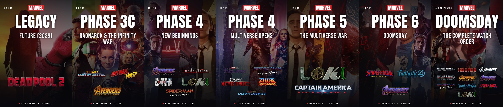
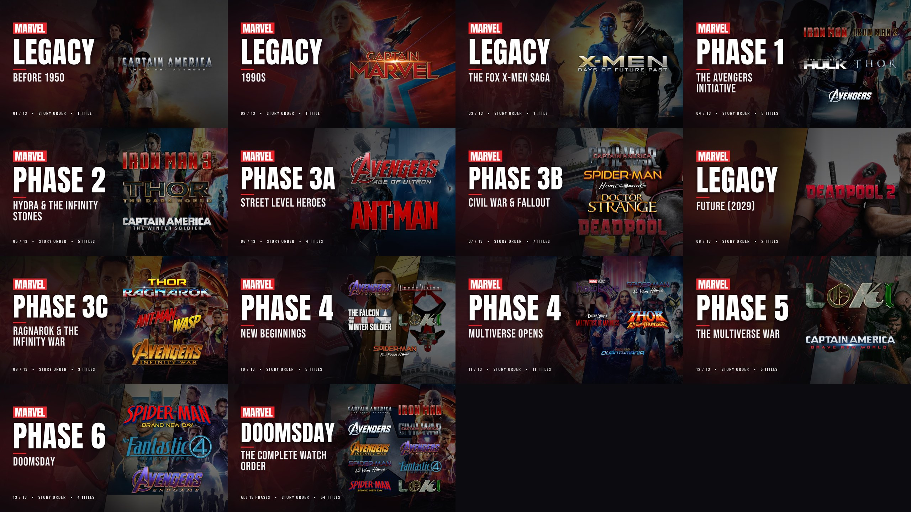

# Doomsday Essentials: 13 phases + playlist

The short road to Avengers: Doomsday: only the titles marvelwatchlist.com marks **essential** or **recommended**, in story order. It's 54 titles across 13 collections, with every credits scene placed where it belongs. This set also includes art for a single **playlist** that holds the whole order.

<b>Landscape / thumb art</b>

## What's in here

- `Marvel 01 - …` through `Marvel 13 - …`: one folder per collection.
- `Playlist - Marvel - Doomsday Watch Order`: art for a playlist called `Marvel: Doomsday Watch Order`.

Each folder holds `poster.jpg`, `backdrop.jpg`, `landscape.jpg`, `logo.png` and `banner.jpg`. Name the collections `Marvel 01: Legacy: Before 1950` and so on (folder names use ` - ` where the collection name has `:`).

**Playlist vs collections:** the collections let you browse by phase; the playlist plays everything back to back. Add movies and each show's episodes in the order below. Credits scenes (↳) aren't separate files: just skip to them in the movie at that point.

## The watch order

<b>Marvel 01: Legacy: Before 1950</b> (1 title)

- `01` Captain America: The First Avenger: Stop before the credits scene; it belongs right before The Avengers

<b>Marvel 02: Legacy: 1990s</b> (1 title)

- `02` Captain Marvel: Stop before the end-credits; the post-credits scene belongs after Infinity War

<b>Marvel 03: Legacy: The Fox X-Men Saga</b> (1 title)

- `03` X-Men: Days of Future Past

<b>Marvel 04: Phase 1 — The Avengers Initiative</b> (5 titles)

- `04` Iron Man: Watch all credits
- `05` Iron Man 2: Stop before the credits scene; it belongs right before Thor
- `06` The Incredible Hulk: Watch all credits
- `07` *↳ Iron Man 2 (post-credits scene)*
- `08` Thor: Stop before the credits scene; it belongs right before The Avengers
- `09` *↳ Captain America: The First Avenger (credits scene)*
- `10` *↳ Thor (post-credits scene)*
- `11` The Avengers: Watch all credits

<b>Marvel 05: Phase 2 — HYDRA & The Infinity Stones</b> (5 titles)

- `12` Iron Man 3
- `13` Thor: The Dark World
- `14` Captain America: The Winter Soldier
- `15` Guardians of the Galaxy
- `16` Guardians of the Galaxy Vol. 2: Watch all 5 credits scenes

<b>Marvel 06: Phase 3A — Street Level Heroes</b> (4 titles)

- `17` Daredevil — Season 1
- `18` Avengers: Age of Ultron
- `19` Ant-Man
- `20` Daredevil — Season 2

<b>Marvel 07: Phase 3B — Civil War & Fallout</b> (7 titles)

- `21` Captain America: Civil War
- `22` Black Widow: Stop before the end-credits; the post-credits scene belongs right before Hawkeye
- `23` Black Panther
- `24` Spider-Man: Homecoming
- `25` Doctor Strange
- `26` Daredevil — Season 3
- `27` Deadpool

<b>Marvel 08: Legacy: Future (2029)</b> (2 titles)

- `28` Logan: Recommended before Deadpool & Wolverine
- `29` Deadpool 2

<b>Marvel 09: Phase 3C — Ragnarok & The Infinity War</b> (3 titles)

- `30` Thor: Ragnarok: Stop before the mid-credits scene; the final end scene belongs here
- `31` Ant-Man and the Wasp: Stop before the credits; the scene belongs right after Infinity War
- `32` *↳ Thor: Ragnarok (mid-credits scene)*
- `33` Avengers: Infinity War: Stop before the post-credits scene
- `34` *↳ Ant-Man and the Wasp (credits scenes)*
- `35` *↳ Avengers: Infinity War (post-credits scene)*
- `36` *↳ Captain Marvel (post-credits scene)*: leads straight into Endgame

<b>Marvel 10: Phase 4 — New Beginnings</b> (5 titles)

- `37` Avengers: Endgame
- `38` WandaVision — Season 1: Stay for episode 9's mid-credits scene (39)
- `40` The Falcon and the Winter Soldier — Season 1
- `41` Loki — Season 1
- `42` Spider-Man: Far From Home

<b>Marvel 11: Phase 4 — Multiverse Opens</b> (11 titles)

- `43` *↳ Black Widow (post-credits scene)*: sets up Hawkeye
- `44` Hawkeye — Season 1
- `45` Shang-Chi and the Legend of the Ten Rings
- `46` Spider-Man: No Way Home
- `47` Doctor Strange in the Multiverse of Madness
- `48` Ms. Marvel — Season 1
- `49` Thor: Love and Thunder
- `50` Black Panther: Wakanda Forever
- `51` Werewolf by Night: Optional special
- `52` Ant-Man and the Wasp: Quantumania
- `53` Guardians of the Galaxy Vol. 3
- `54` The Marvels

<b>Marvel 12: Phase 5 — The Multiverse War</b> (5 titles)

- `55` Loki — Season 2
- `56` Deadpool & Wolverine
- `57` Daredevil: Born Again — Season 1
- `58` Captain America: Brave New World
- `59` Thunderbolts*: Stop before the post-credits scene; it belongs right before Doomsday

<b>Marvel 13: Phase 6 — Doomsday</b> (4 titles)

- `60` Daredevil: Born Again — Season 2
- `61` Spider-Man: Brand New Day
- `62` The Fantastic Four: First Steps
- `63` Avengers: Endgame Encore (new scenes): See it after Brand New Day if you can
- `64` *↳ Thunderbolts* (post-credits scene)*

---

Want everything (Fox X-Men, Sony Spider-Man, the Netflix shows, One-Shots)? See [Complete Watch Order](../Complete%20Watch%20Order/).
