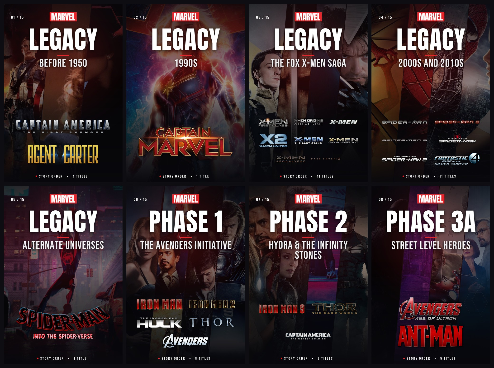
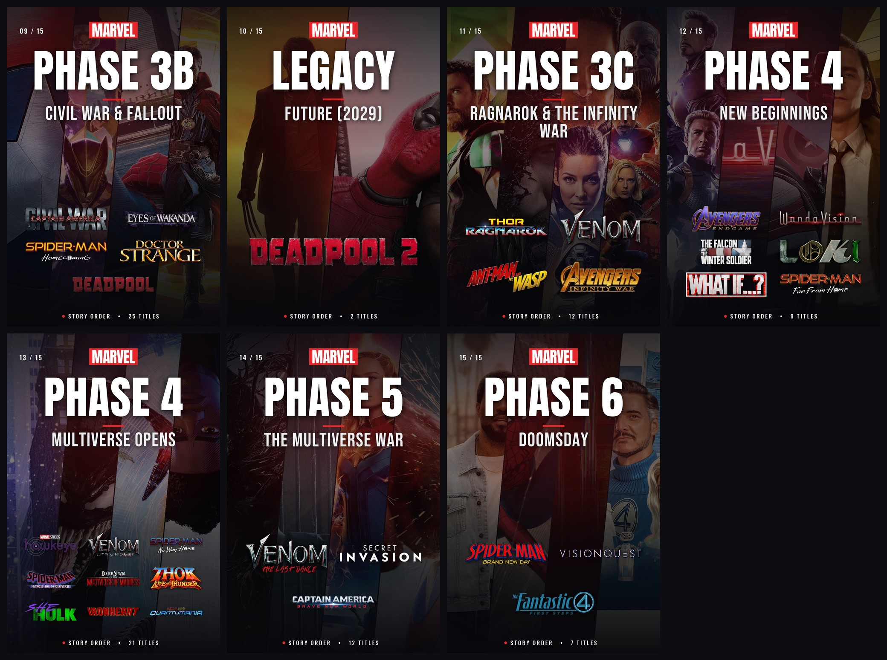
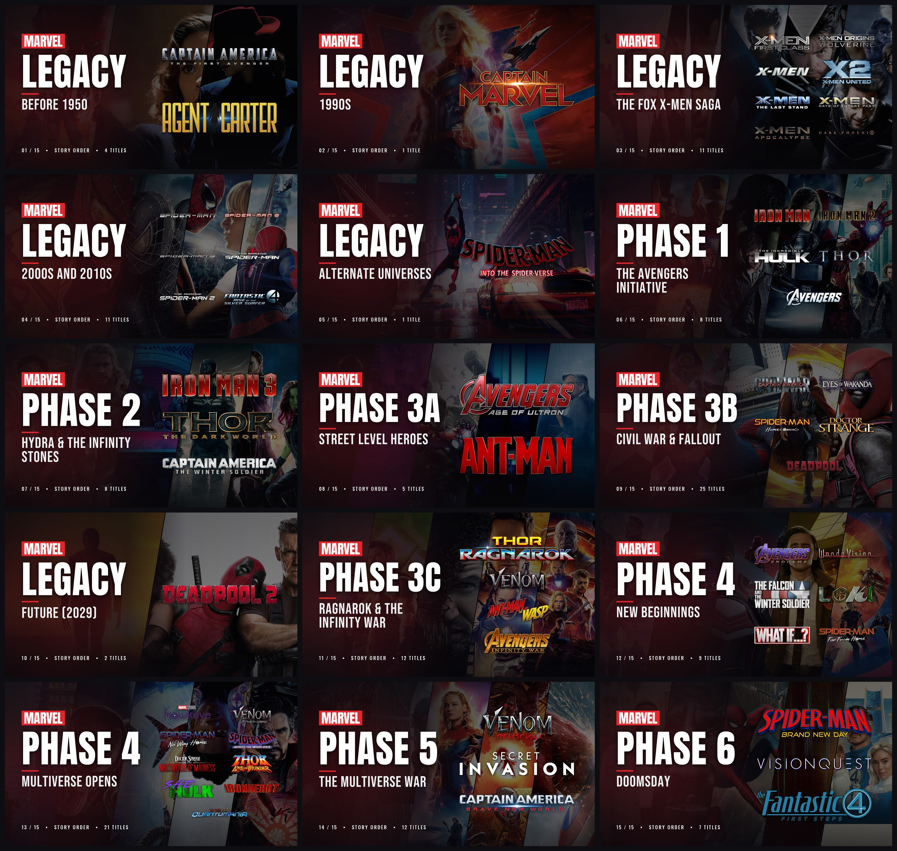
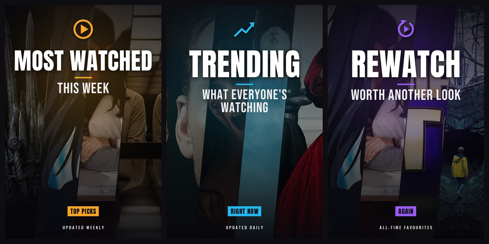

# Marvel Phase Collections

*Story-order artwork for all 15 Marvel phases, plus 3 bonus sets.*




<details><summary><b>Landscape / thumb art</b></summary>



</details>

<details><summary><b>Bonus: Most Watched This Week · Trending · Rewatch</b></summary>



</details>

## Download

Use the green **Code → Download ZIP** button at the top of this repo, or clone it:

```
git clone https://github.com/psmattas/marvel-phase-collections.git
```

Folders: `Marvel Watch Order/` (15 phase sets) and `Dynamic Collections/` (3 bonus sets). Each folder holds `poster.jpg`, `backdrop.jpg`, `landscape.jpg`, `logo.png` and `banner.jpg`.

I made a set of custom collection artwork for watching the whole Marvel saga in **story (chronological) order** before Avengers: Doomsday. There are 15 phase collections, plus 3 bonus artwork sets for dynamic collections (Most Watched This Week, Trending, Rewatch).

Every collection comes with **poster, backdrop, landscape/thumb, logo and banner** in Jellyfin's naming (`poster.jpg`, `backdrop.jpg`, `landscape.jpg`, `logo.png`, `banner.jpg`), so they also work for Emby/Plex with a quick rename.


**How to use (Jellyfin)**

1. Create the collections (names below). I name them `Marvel 01: Legacy: Before 1950` and so on, so they sort in order.
2. Open each collection → ⋮ → *Edit Images* → upload each file. Or drop the files into `config/data/collections/<Collection Name> [boxset]/`.
3. **Ordering tip:** Jellyfin collections sort by name or date, not a custom order. Set each item's *Sort Title* to `Marvel 001 - …`, `Marvel 002 - …` (the numbers below), and set the collection's display order to *Sort Name*. Each phase then plays in exact story order. For shows, add the individual **season** to the collection rather than the whole series, so each season sits in its own phase.

**The watch order, 137 entries across 15 collections**

<details><summary><b>Marvel 01: Legacy: Before 1950</b> (4 entries)</summary>

- `001` Captain America: The First Avenger
- `002` Marvel One-Shot: Agent Carter
- `003` Marvel's Agent Carter — Season 1
- `004` Marvel's Agent Carter — Season 2

</details>

<details><summary><b>Marvel 02: Legacy: 1990s</b> (1 entries)</summary>

- `005` Captain Marvel

</details>

<details><summary><b>Marvel 03: Legacy: The Fox X-Men Saga</b> (11 entries)</summary>

- `006` X-Men: First Class
- `007` X-Men Origins: Wolverine
- `008` X-Men
- `009` X2
- `010` X-Men: The Last Stand
- `011` The Wolverine
- `012` X-Men: Days of Future Past
- `013` X-Men: Apocalypse
- `014` Dark Phoenix
- `015` Blade
- `016` Blade II

</details>

<details><summary><b>Marvel 04: Legacy: 2000s and 2010s</b> (11 entries)</summary>

- `017` Blade: Trinity
- `018` Blade: The Series — Season 1
- `019` Spider-Man
- `020` Spider-Man 2
- `021` Spider-Man 3
- `022` The Amazing Spider-Man
- `023` The Amazing Spider-Man 2
- `024` Daredevil
- `025` Elektra
- `026` Fantastic Four
- `027` Fantastic Four: Rise of the Silver Surfer

</details>

<details><summary><b>Marvel 05: Legacy: Alternate Universes</b> (1 entries)</summary>

- `028` Spider-Man: Into the Spider-Verse

</details>

<details><summary><b>Marvel 06: Phase 1 — The Avengers Initiative</b> (8 entries)</summary>

- `029` Iron Man
- `030` Iron Man 2
- `031` The Incredible Hulk
- `032` Marvel One-Shot: The Consultant
- `033` Marvel One-Shot: A Funny Thing Happened on the Way to Thor's Hammer
- `034` Thor
- `035` The Avengers
- `036` Marvel One-Shot: Item 47

</details>

<details><summary><b>Marvel 07: Phase 2 — HYDRA & The Infinity Stones</b> (8 entries)</summary>

- `037` Iron Man 3
- `038` Thor: The Dark World
- `039` Marvel's Agents of S.H.I.E.L.D. — Season 1
- `040` Marvel One-Shot: All Hail the King
- `041` Captain America: The Winter Soldier
- `042` Guardians of the Galaxy
- `043` Guardians of the Galaxy Vol. 2
- `044` Marvel's Agents of S.H.I.E.L.D. — Season 2

</details>

<details><summary><b>Marvel 08: Phase 3A — Street Level Heroes</b> (5 entries)</summary>

- `045` Marvel's Daredevil — Season 1
- `046` Marvel's Jessica Jones — Season 1
- `047` Avengers: Age of Ultron
- `048` WHIH Newsfront — Season 1
- `049` Ant-Man

</details>

<details><summary><b>Marvel 09: Phase 3B — Civil War & Fallout</b> (25 entries)</summary>

- `050` Marvel's Agents of S.H.I.E.L.D. — Season 3
- `051` Marvel's Daredevil — Season 2
- `052` WHIH Newsfront — Season 2
- `053` Captain America: Civil War
- `054` Team Thor
- `055` Team Thor: Part 2
- `056` Marvel's Luke Cage — Season 1
- `057` Marvel's Iron Fist — Season 1
- `058` Marvel's The Defenders — Season 1
- `059` Black Widow
- `060` Eyes of Wakanda — Season 1
- `061` Black Panther
- `062` Spider-Man: Homecoming
- `063` Marvel's The Punisher — Season 1
- `064` Doctor Strange
- `065` Marvel's Cloak & Dagger — Season 1
- `066` Marvel's Agents of S.H.I.E.L.D. — Season 4
- `067` Marvel's Agents of S.H.I.E.L.D.: Slingshot — Season 1
- `068` Marvel's Inhumans — Season 1
- `069` Marvel's Jessica Jones — Season 2
- `070` Marvel's Luke Cage — Season 2
- `071` Marvel's Iron Fist — Season 2
- `072` Marvel's Daredevil — Season 3
- `073` Marvel's Cloak & Dagger — Season 2
- `074` Deadpool

</details>

<details><summary><b>Marvel 10: Legacy: Future (2029)</b> (2 entries)</summary>

- `075` Logan
- `076` Deadpool 2

</details>

<details><summary><b>Marvel 11: Phase 3C — Ragnarok & The Infinity War</b> (12 entries)</summary>

- `077` Marvel's Agents of S.H.I.E.L.D. — Season 5
- `078` Marvel's Runaways — Season 1
- `079` Marvel's Runaways — Season 2
- `080` Marvel's Runaways — Season 3
- `081` Thor: Ragnarok
- `082` Team Darryl
- `083` Marvel's The Punisher — Season 2
- `084` Marvel's Jessica Jones — Season 3
- `085` Venom
- `086` Ant-Man and the Wasp
- `087` Avengers: Infinity War
- `088` Helstrom — Season 1

</details>

<details><summary><b>Marvel 12: Phase 4 — New Beginnings</b> (9 entries)</summary>

- `089` Avengers: Endgame
- `090` Avengers: Endgame Encore
- `091` WandaVision — Season 1
- `092` The Falcon and the Winter Soldier — Season 1
- `093` Loki — Season 1
- `094` What If...? — Season 1
- `095` Marvel's Agents of S.H.I.E.L.D. — Season 6
- `096` Marvel's Agents of S.H.I.E.L.D. — Season 7
- `097` Spider-Man: Far From Home

</details>

<details><summary><b>Marvel 13: Phase 4 — Multiverse Opens</b> (21 entries)</summary>

- `099` Hawkeye — Season 1
- `100` Eternals
- `101` Shang-Chi and the Legend of the Ten Rings
- `102` Venom: Let There Be Carnage
- `104` Spider-Man: No Way Home
- `105` Spider-Man: Across the Spider-Verse
- `107` Morbius
- `108` Doctor Strange in the Multiverse of Madness
- `109` Moon Knight — Season 1
- `110` Ms. Marvel — Season 1
- `111` Thor: Love and Thunder
- `112` Black Panther: Wakanda Forever
- `113` She-Hulk: Attorney at Law — Season 1
- `114` Echo — Season 1
- `115` Ironheart — Season 1
- `116` Werewolf by Night
- `117` The Guardians of the Galaxy Holiday Special
- `118` I Am Groot — Season 1
- `119` I Am Groot — Season 2
- `120` Ant-Man and the Wasp: Quantumania
- `121` Guardians of the Galaxy Vol. 3

</details>

<details><summary><b>Marvel 14: Phase 5 — The Multiverse War</b> (12 entries)</summary>

- `122` Venom: The Last Dance
- `123` Secret Invasion — Season 1
- `124` The Marvels
- `125` Marvel Zombies — Season 1
- `126` Loki — Season 2
- `127` What If...? — Season 2
- `128` What If...? — Season 3
- `129` Deadpool & Wolverine
- `130` Agatha All Along — Season 1
- `131` Daredevil: Born Again — Season 1
- `132` Captain America: Brave New World
- `133` Thunderbolts*

</details>

<details><summary><b>Marvel 15: Phase 6 — Doomsday</b> (7 entries)</summary>

- `134` Wonder Man — Season 1
- `135` Daredevil: Born Again — Season 2
- `136` The Punisher: One Last Kill
- `137` Spider-Man: Brand New Day
- `138` VisionQuest — Season 1
- `139` The Fantastic 4: First Steps
- `140` Avengers: Doomsday

</details>

---

Watch order based on marvelwatchlist.com (story order). Backdrops and logos from fanart.tv / TMDB. Fonts: Anton, Bebas Neue, Oswald (SIL OFL). Fan-made, not affiliated with Marvel or Disney.